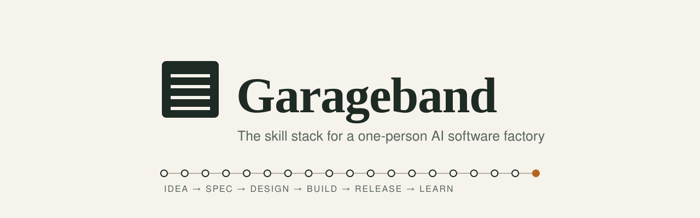
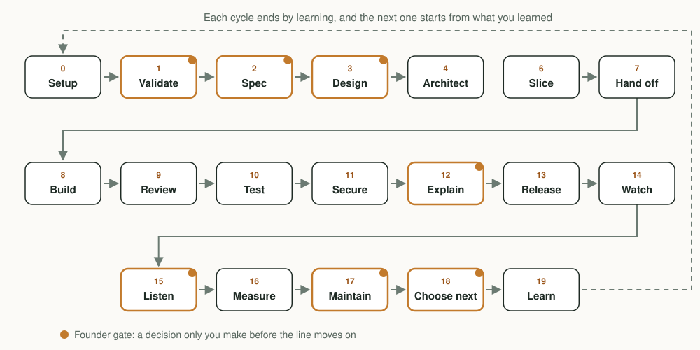

<p align="center">
  <picture>
    <source media="(prefers-color-scheme: dark)" srcset="assets/banner-dark.svg">
    
  </picture>
</p>

<p align="center"><b>Turn a founder and a few AI models into a professional software team.</b></p>

<p align="center">
  <a href="LICENSE"></a>
  
  
  
  <a href="https://github.com/milllenialfalcon/Garageband/actions/workflows/validate.yml"></a>
</p>

<p align="center">
  <b><a href="#install">Install</a></b> &nbsp;·&nbsp; <b><a href="#how-it-works">How it works</a></b> &nbsp;·&nbsp; <b><a href="#skills">Skills</a></b> &nbsp;·&nbsp; <b><a href="#gates">Gates</a></b> &nbsp;·&nbsp; <b><a href="#faq">FAQ</a></b>
</p>

---

Garageband gives every AI model the same playbook: 36 skills covering the whole lifecycle, from "should this exist?" to "what did we learn?". The important rules are backed by checks that run in git and CI, so they hold even when a model ignores its instructions.

## Why Garageband

- **Built for founders who don't come from software.** You decide *what* and *whether*. The factory handles *how*, and asks you only when it matters.
- **Works across models.** Claude, Codex, DeepSeek or any other model follows the same stages, the same tickets and the same handoffs. State lives in the repo, not in any one tool's memory.
- **Gates that machines enforce.** Prose skills guide. Branch protection, CI, a pre-push guard and a design checker guarantee.

---

## Install

**You need:** a GitHub account, `git` (2.20 or newer), Node.js 22 or newer, and for branch protection the GitHub CLI (`gh`, logged in with `gh auth login`). Plus at least one AI coding tool: Claude Code, Codex or OpenCode.

### Claude Code

```
/plugin marketplace add milllenialfalcon/Garageband
/plugin install garageband@garageband
```

Skills appear as `garageband:<skill>`. The plugin also adds a safety hook that blocks destructive commands and pushes to `main`.

### Codex, OpenCode and other tools

```
curl -fsSL https://raw.githubusercontent.com/milllenialfalcon/Garageband/main/install.sh | bash
```

This installs into `~/.agents/skills`, which both Codex and OpenCode read. Alternative: `npx skills add milllenialfalcon/Garageband`.

> Use the plugin for Claude Code and the script for everything else. Installing into `~/.claude/skills` as well would make OpenCode see every skill twice.

### Set up a project (once per repo)

In any tool, ask: **"use the project-bootstrap skill"**, or run it directly:

```
bash ~/.agents/skills/project-bootstrap/scripts/bootstrap.sh path/to/repo --protect
```

It adds the project kit without overwriting your files: `AGENTS.md` constitution, `PRODUCT.md`, `DESIGN.md`, spec/ADR/ticket/brief templates, PR template, the CI quality gate, a git guard hook and `slop-lint`. `--protect` turns on GitHub branch protection.

For a brand-new app, create the app in an empty folder first (the skill gives the exact command), then run bootstrap on it.

**Shared factory state.** Bootstrap creates `.factory/` as a separate checkout of a `factory-state` branch. The ledger, tickets, briefs and handoffs live there and never merge into `main`, so every model in every tool sees who's doing what as soon as it's pushed.

**Git guard per clone.** The pre-push guard is switched on for the folder you bootstrap. On any other clone of the project, run `git config core.hooksPath .githooks` once.

---

## Start

Open any session and say **"use the garageband skill"** (Codex: `$garageband`). It reads the project, classifies your request as a **spike**, **bounded** change or **architectural** work, tells you the stages it will run and where it needs you, then starts.

---

## How it works

<p align="center">
  <picture>
    <source media="(prefers-color-scheme: dark)" srcset="assets/lifecycle-dark.svg">
    
  </picture>
</p>

| # | Stage | Skills | Gate |
|---|---|---|---|
| 0 | Setup (first, once per project) | `project-bootstrap` | Green CI on a test PR |
| 1 | Should this exist? | `validate-idea` | Founder: build / shrink / don't build |
| 2 | What exactly? | `grill-founder` → `write-spec` | Founder approves spec |
| 3 | Look and feel | `design-system` → `design-variants` | Founder picks a variant |
| 4 | Structure | `architecture-plan` → `decision-log` | Second-model review passes |
| 5 | Break down | `slice-tickets` | Every ticket has a verify step |
| 6 | Hand off | `dispatch-brief`, `factory-ledger`, `model-router` | Reader test finds no ambiguity |
| 7 | Build | `tdd-slice`, `ui-build-rules`, `safe-migration`, `root-cause-debug` | Tests green, evidence pasted |
| 8 | Review | `doubt-review`, `design-critique` | A different model approves |
| 9 | Test | `browser-qa`, `break-ui`, `slop-gate` | CI green |
| 10 | Secure | `security-pass`, `launch-compliance` | No critical findings |
| 11 | Explain | `owner-pr-summary` | Founder understands and merges |
| 12 | Release | `ship-gate` | Founder says GO; tested rollback ready |
| 13 | Watch | `watch-after-ship` | Metrics within thresholds |
| 14 | Listen | `intake-triage` | Weekly queue approved |
| 15 | Measure | `measure-outcome` | Founder: keep / iterate / kill |
| 16 | Maintain | `maintenance-sweep`, `cost-watch` | Monthly report approved |
| 17 | Choose next | `portfolio-priority` | Next bet picked |
| 18 | Learn | `retro-instincts`, `skill-lab` | Rules updated, skills proven |

Everywhere: `garageband` routes, `decision-brief` frames every choice, `verify-research` checks anything a research model produced.

---

## Skills

All 36 skills, grouped by layer.

<details open>
<summary><b>Founder layer</b> · 4 skills</summary>

| Skill | What it does |
|---|---|
| `garageband` | Entry point. Routes any request to the right path, skills and models |
| `grill-founder` | Rounds of plain-English questions with recommended answers ("yes" accepts) |
| `decision-brief` | Mechanical / Taste / Founder Call; one-way vs two-way door; one-minute briefs |
| `owner-pr-summary` | PR descriptions a non-engineer can approve from |

</details>

<details open>
<summary><b>Define</b> · 2 skills</summary>

| Skill | What it does |
|---|---|
| `validate-idea` | Forcing questions, competitor check, build / shrink / don't-build |
| `write-spec` | Given/When/Then criteria, not-doing list, metric with tracking events |

</details>

<details open>
<summary><b>Design</b> · 5 skills</summary>

| Skill | What it does |
|---|---|
| `design-system` | Screen modes, three founder dials, tokens in `DESIGN.md`, anti-generic check |
| `design-variants` | Three working variants on named axes; founder picks; losers deleted |
| `ui-build-rules` | Craft floor: tokens, components, states, accessibility, motion, copy, i18n |
| `design-critique` | Fresh reviewer, four widths, ten heuristics /40, Block or Approve |
| `break-ui` | Worst-case realistic data, including Indian scripts and number formats |

</details>

<details open>
<summary><b>Architect and set up</b> · 3 skills</summary>

| Skill | What it does |
|---|---|
| `architecture-plan` | Data model, contracts, flows, security, tracking plan; second-model review |
| `decision-log` | ADRs, decision log, glossary |
| `project-bootstrap` | Project kit, default stack, environments, secrets, backups, branch protection |

</details>

<details open>
<summary><b>Plan and hand off</b> · 5 skills</summary>

| Skill | What it does |
|---|---|
| `slice-tickets` | Thin vertical tickets with verify steps, models and dependencies |
| `dispatch-brief` | Search-first, self-contained briefs, reader test, claim in ledger |
| `factory-ledger` | Shared state across tools; claims, attempts, handoff notes |
| `model-router` | Tiers, author ≠ reviewer, escalation ladder, quota protection |
| `verify-research` | Claim-by-claim checking against primary sources |

</details>

<details open>
<summary><b>Build</b> · 3 skills</summary>

| Skill | What it does |
|---|---|
| `tdd-slice` | Failing test first, surgical diff, fresh evidence before "done" |
| `root-cause-debug` | Reproduce, narrow, fix with a regression test; three strikes then escalate |
| `safe-migration` | Expand → migrate → contract, backups, tested rollback |

</details>

<details open>
<summary><b>Verify</b> · 5 skills</summary>

| Skill | What it does |
|---|---|
| `doubt-review` | Artifact-and-contract-only review, two axes, sideways sweep, max 3 rounds |
| `browser-qa` | Playwright flows from criteria, widths, accessibility, speed, QA brakes |
| `slop-gate` | Deterministic design and accessibility checks in CI |
| `security-pass` | Threat sketch, OWASP-style checklist, GO / NO-GO |
| `launch-compliance` | Privacy (incl. India's DPDP Act), terms, payments and tax, licences |

</details>

<details open>
<summary><b>Ship and operate</b> · 5 skills</summary>

| Skill | What it does |
|---|---|
| `ship-gate` | Go/no-go, rollback plan, release notes, staged rollout |
| `watch-after-ship` | Thresholds vs baseline, flag-off on breach, incidents, postmortems |
| `intake-triage` | Feedback and bug reports into labelled tickets; weekly queue |
| `cost-watch` | Monthly running costs, spikes, waste, free-tier headroom |
| `maintenance-sweep` | Dependencies, backup restore test, expiries, flags, tech debt |

</details>

<details open>
<summary><b>Measure and learn</b> · 4 skills</summary>

| Skill | What it does |
|---|---|
| `measure-outcome` | Metric vs target, funnel, keep / iterate / kill |
| `portfolio-priority` | Impact × reach × confidence × fit ÷ effort; next three bets |
| `retro-instincts` | Evidence-based retros; learned rules promoted only when repeated |
| `skill-lab` | With/without tests per model to prove each skill actually works |

</details>

---

## Gates

What machines enforce. These work with every model, because they live in git and GitHub, not in the prompt.

| Guard | Where | Stops |
|---|---|---|
| Branch protection | GitHub | Merging without green `quality`, `e2e` and `secrets` checks, force pushes, deleting `main` |
| `garageband-ci` | GitHub Actions | Failing typecheck, lint, tests, e2e (incl. speed budget), slop-lint errors, high/critical vulnerabilities, leaked secrets; advisory checks for new GPL/AGPL dependencies |
| `.githooks/pre-push` | Every bootstrapped clone (others: `git config core.hooksPath .githooks`) | Pushing to `main`, force pushes, obvious secret keys |
| `slop-lint` | Local and CI | Disabled zoom, removed focus outlines, missing alt text; warns on AI-template looks and off-token colours and fonts |
| Plugin guard hook | Claude Code | Destructive shell commands, `reset --hard`, dropping tables, agent-merged PRs |

Prose skills guide; these gates guarantee.

---

## Multi-model setup

Write your roles in `AGENTS.md` section 10. An example that works well on small budgets:

| Role | Example |
|---|---|
| Orchestrator (thinking, specs, risky review) | Claude (strongest model) |
| Frontend implementer | Codex (GPT) |
| Backend implementer (most tickets) | DeepSeek via OpenCode |
| Checker (reader tests, routine review, triage) | Claude Haiku or a small GPT model |
| Researchers (untrusted until checked) | Free models |

State lives in the repo (`.factory/`, `docs/`), not in any tool's memory, so models can hand work to each other across tools.

---

## FAQ

<details>
<summary><b>Do I need to know how to code?</b></summary>

Garageband is written for founders who don't come from software. You decide what to build and whether to build it; the factory handles how and asks you only at the founder gates shown above. You still need the prerequisites in [Install](#install): a GitHub account, git, Node.js 22 or newer, and an AI coding tool.

</details>

<details>
<summary><b>Which models does it work with?</b></summary>

Garageband installs for Claude Code (as a plugin) and for Codex and OpenCode (through `~/.agents/skills`), and it is built so that any model can take part. The multi-model table above shows one arrangement that works well on small budgets. Roles are set in `AGENTS.md` section 10, and state is shared through the repo, so models can hand work to each other across tools.

</details>

<details>
<summary><b>Will it fight with other skill stacks?</b></summary>

Claude Code users get Garageband skills under the `garageband:` namespace. For other tools, `install.sh` never overwrites a skill folder it did not install: if a folder with the same name already exists and isn't from Garageband, it is skipped and reported, so you can rename or remove it and re-run. Install through one route per tool: the plugin for Claude Code, the script for everything else, because installing into `~/.claude/skills` as well would make OpenCode see every skill twice.

</details>

<details>
<summary><b>What does it cost?</b></summary>

Garageband is free under the MIT licence. Its own README does not list model or hosting prices, so your costs come from the AI tools and services you choose. The `cost-watch` skill produces a monthly report of running costs, spikes and free-tier headroom, and `model-router` includes quota protection.

</details>

<details>
<summary><b>Is it safe?</b></summary>

Several guards are enforced by machines, not by the model's good intentions: branch protection, a CI workflow that scans for leaked secrets and high or critical vulnerabilities, a pre-push guard that blocks pushes to `main`, and a Claude Code hook that blocks destructive commands and agent-merged PRs. The `security-pass` skill adds a threat sketch and a GO / NO-GO review. Garageband is still v0.1.0: prove each skill on your own models with `skill-lab` before you rely on it. `launch-compliance` drafts legal documents for a lawyer to review; it is not legal advice.

</details>

---

## Update and remove

- Claude Code: `/plugin` → update, or `/plugin uninstall garageband@garageband`.
- Other tools: re-run the install line to update; add `--uninstall` to remove.
- Project kit files belong to your project after bootstrap; update them by hand or re-run bootstrap (it never overwrites).

## Status

v0.1.0. Every skill should be proven on your models with `skill-lab` before you rely on it; results differ by model. Not legal advice: `launch-compliance` drafts documents for a lawyer to review.

---

<p align="center">
  <a href="CONTRIBUTING.md">Contributing</a> &nbsp;·&nbsp; <a href="SECURITY.md">Security</a> &nbsp;·&nbsp; Credits and influences: <a href="NOTICE.md">NOTICE.md</a> &nbsp;·&nbsp; Licence: <a href="LICENSE">MIT</a><br>
  <sub>"Garageband" is a working name for this project and is not affiliated with Apple or its GarageBand software.</sub>
</p>
